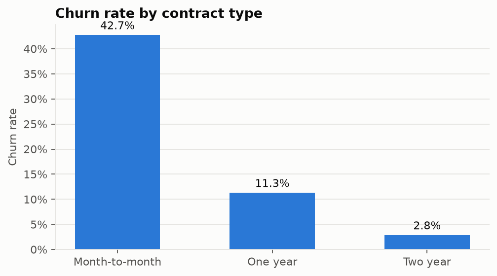
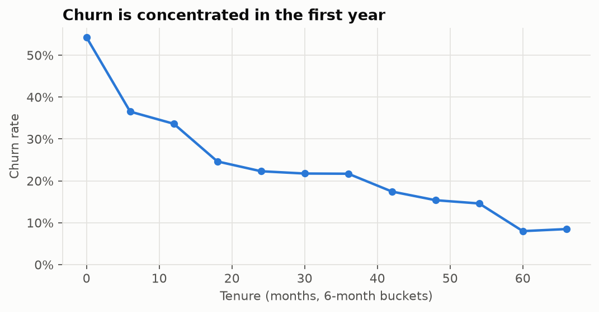
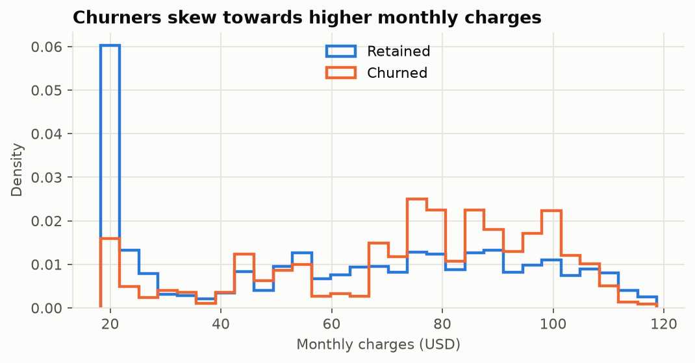
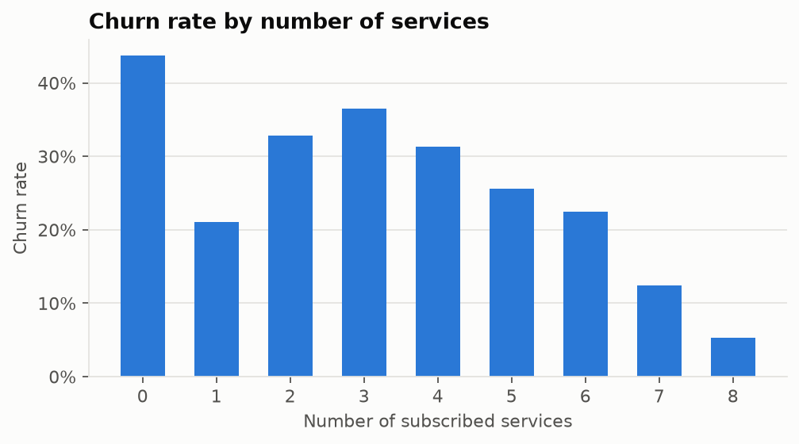
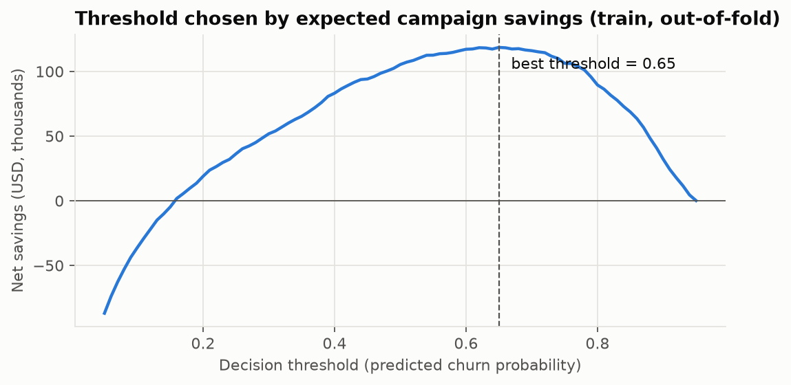
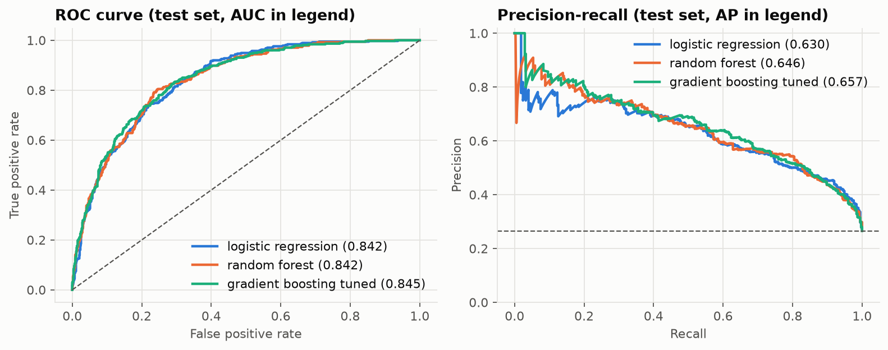
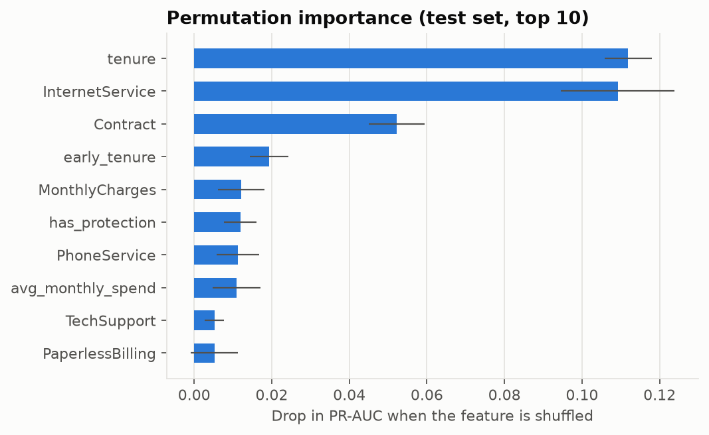

# Customer Churn Analytics & Retention Targeting

An end-to-end data science project on the IBM Telco Customer Churn dataset
(7,043 customers, 26.5% churn). It goes from raw CSV to a decision a business
can act on: **which customers should get a retention offer, and is it worth
the money?**

The project covers the full workflow: data quality checks, SQL analysis on a
normalized database, exploratory analysis, statistical hypothesis testing,
feature engineering, model comparison with cross-validation, and choosing a
decision threshold by expected campaign savings instead of the default 0.5.

## Key results

| Question | Finding |
|---|---|
| Data quality | TotalCharges is stored as text with **11 hidden blank values** (not counted as missing by pandas). All 11 are tenure-0 customers who have not been billed, so they are set to 0, not imputed with the mean. |
| Where is churn? | Month-to-month contracts churn at **42.7%** vs 11.3% (one year) and 2.8% (two year), and account for **86.9% of lost monthly revenue**. |
| When does it happen? | **52.9%** of customers in their first 6 months churn; the first year holds **55.5%** of all churners. |
| Is the contract gap real? | Two-proportion z-test: z = 34.0, p < 1e-250; bootstrap 95% CI for the gap: **34.2 to 37.8 percentage points**. |
| Strongest associations | Cramér's V: Contract 0.41, InternetService 0.32, PaymentMethod 0.30 (all significant after Bonferroni correction). |
| Model quality (hold-out test) | Logistic regression: **ROC-AUC 0.842, PR-AUC 0.630**, top-decile lift **2.8x**. |
| Business impact (hold-out test) | At the savings-optimal threshold (0.65) the model campaign nets **$25.1K**, vs **$6.6K** for a "target every month-to-month customer" rule and **-$42.9K** for targeting everyone. It also beats the default 0.5 threshold ($22.6K) by 11%. |

Business numbers use assumed values set in `src/config.py` ($100 per offer,
30% of targeted churners retained, 12 months of revenue credited per saved
customer). Change them there and rerun to see how the decision moves.

## Pipeline

```
raw CSV
  -> data_prep.py      profile (duplicates, hidden blanks, consistency) and clean
  -> sql_analysis.py   load into a normalized SQLite DB, run 5 analysis queries
  -> eda.py            4 figures + tables answering one business question each
  -> stats_tests.py    chi-square + Cramér's V, Mann-Whitney U, z-test, bootstrap CI
  -> features.py       6 engineered features + leakage-safe preprocessing pipeline
  -> modeling.py       CV model comparison, tuning, threshold by savings, evaluation
```

Everything runs with one command and writes its outputs to `reports/`.

## Project structure

```
churn-retention-analytics/
├── data/raw/Telco-Customer-Churn.csv   # source data (IBM sample dataset)
├── sql/
│   ├── schema.sql                      # customers, accounts, services tables
│   └── queries/                        # q1-q5 analysis queries
├── src/
│   ├── config.py                       # paths, seeds, business assumptions
│   ├── data_prep.py                    # quality report + cleaning rules
│   ├── sql_analysis.py                 # build SQLite DB, run queries
│   ├── eda.py                          # exploratory figures and tables
│   ├── stats_tests.py                  # hypothesis tests with effect sizes
│   ├── features.py                     # feature engineering + preprocessing
│   ├── modeling.py                     # training, threshold choice, evaluation
│   └── plot_style.py                   # shared chart styling
├── tests/test_pipeline.py              # unit tests (cleaning, SQL, features, business logic)
├── reports/                            # all generated tables, figures, metrics
├── run_pipeline.py                     # runs everything end to end
└── requirements.txt
```

## How to run

```bash
python -m venv .venv
source .venv/bin/activate          # Windows: .venv\Scripts\activate
pip install -r requirements.txt

python run_pipeline.py             # about 1 minute on a laptop
pytest -q                          # 7 tests
```

## 1. Data quality and cleaning

`data_prep.py` profiles the raw file before changing anything and saves the
profile to `reports/data_quality.json`.

- No duplicate customer IDs and no missing values *as loaded*, but
  TotalCharges is a text column containing 11 blank strings. Converting to
  numeric exposes them.
- The code asserts that every blank belongs to a tenure-0 customer before
  filling it with 0. If that rule ever stopped holding, the pipeline would fail
  instead of silently imputing.
- "No internet service" and "No phone service" are merged into "No", since
  InternetService and PhoneService already record that information. This
  removes redundant one-hot columns.
- A consistency check compares TotalCharges with tenure × MonthlyCharges;
  only 0.84% of rows differ by more than 20%, which is plausible from price
  changes over time.

## 2. SQL analysis

The flat CSV is split into three tables (`customers`, `accounts`, and a
long-format `services` table) so the queries use joins, CTEs, CASE
expressions and window functions (`SUM() OVER`, `RANK() OVER (PARTITION BY)`,
`NTILE`). SQLite needs no setup; the SQL is standard and ports to PostgreSQL
or MySQL.

| Query | What it answers |
|---|---|
| `q1_churn_by_contract` | Churn rate and share of lost revenue per contract type |
| `q2_churn_by_tenure_cohort` | Churn by tenure cohort with cumulative share of churners |
| `q3_service_adoption_vs_churn` | Churn among subscribers vs non-subscribers of each service |
| `q4_payment_method_risk` | Payment-method risk ranked *within* each contract type |
| `q5_high_value_at_risk` | Churn for top-quartile spenders on month-to-month plans |

Notable results:
- Among internet customers, those with **OnlineSecurity** churn at 14.6% vs
  41.8% without it, and **TechSupport** shows a similar gap (15.2% vs 41.6%).
  Streaming services show almost no gap.
- **Electronic check** is the riskiest payment method in *every* contract type,
  so the effect is not only because month-to-month customers use it more.
- Top-quartile spenders on month-to-month plans (871 customers) churn at
  **52.1%** and account for about a third of all lost monthly revenue.

## 3. Exploratory analysis

| | |
|---|---|
|  |  |
|  |  |

## 4. Statistical tests

With 7,000 rows almost any difference is statistically significant, so every
test also reports an effect size.

- **Chi-square + Cramér's V** for each categorical feature vs churn, with a
  Bonferroni correction for running 16 tests.
- **Mann-Whitney U + rank-biserial correlation** for tenure and charges (both
  clearly non-normal). Median tenure is 10 months for churners vs 38 for
  retained customers (rank-biserial -0.48).
- **Two-proportion z-test and bootstrap 95% CI** (5,000 resamples) for the
  month-to-month vs longer-contract gap.

Outputs: `reports/stats/`.

## 5. Feature engineering

Six features encode business intuition: number of services, whether the
customer has security or tech support, average historical monthly spend,
the increase of the current bill over that average, automatic payment, and
whether the customer is in the first 12 months.

All learned transforms (scaling, one-hot encoding) live inside a scikit-learn
`ColumnTransformer` inside the model `Pipeline`, so they are refit on each
training fold and never see validation or test data.

**Honest ablation:** with logistic regression, adding the engineered features
leaves CV PR-AUC essentially unchanged (0.660 vs 0.660). The raw columns
already carry the same signal (for example, tenure already encodes "first
year"). The engineered features are kept because they make the model easier
to explain, and `early_tenure` and `has_protection` still rank in the top 6 by
permutation importance.

## 6. Modeling

**Evaluation design**
- Stratified 80/20 split; the test set is used once, at the end.
- 5-fold stratified cross-validation on the training set to compare models.
- Models ranked by **PR-AUC**, because accuracy is misleading at 26.5% churn:
  predicting "no churn" for everyone already scores 73.5%.

**Cross-validation (training set, mean of 5 folds)**

| Model | ROC-AUC | PR-AUC | Recall @0.5 | F1 @0.5 |
|---|---|---|---|---|
| Logistic regression (class-weighted) | 0.846 | **0.660** | 0.80 | 0.63 |
| Random forest | 0.845 | 0.658 | 0.71 | 0.63 |
| Gradient boosting (25-iteration randomized search) | 0.846 | 0.657 | 0.79 | 0.63 |
| Prior-only baseline | 0.500 | 0.265 | 0.00 | 0.00 |

All three models land within one standard deviation of each other (PR-AUC
std about 0.015 to 0.02), so the simplest, most interpretable one,
**logistic regression**, is selected. Tuned boosting did not beat it on this
small tabular dataset.

On the hold-out set, tuned boosting scores slightly higher PR-AUC (0.657 vs
0.630; see the curves below). The choice is still made on cross-validation,
not on the test set: picking whichever model looks best on the test set would
turn it into a second validation set and make the reported numbers optimistic.

**Threshold chosen by money, not by 0.5.** For each threshold, expected net
savings = (value kept from targeted churners) − (cost of every offer sent).
The threshold is chosen on **out-of-fold training predictions**, so it is
never tuned on the test set.



**Hold-out test results (threshold 0.65)**

| Metric | Value |
|---|---|
| ROC-AUC | 0.842 |
| PR-AUC | 0.630 (base rate 0.265) |
| Precision / Recall | 0.58 / 0.64 |
| Top-decile lift | 2.8x |

**Campaign comparison on the test set (1,409 customers)**

| Policy | Targeted | Churners reached | Net savings |
|---|---|---|---|
| **Model, savings-optimal threshold** | 415 | 241 | **$25,106** |
| Model, default 0.5 threshold | 580 | 294 | $22,618 |
| Rule: every month-to-month customer | 773 | 329 | $6,646 |
| Rule: everyone | 1,409 | 374 | −$42,926 |



**What drives predictions:** permutation importance (drop in test PR-AUC when
a column is shuffled) ranks tenure, internet service type and contract far
above everything else.



`reports/modeling/test_risk_ranking.csv` is the deliverable a retention team
would receive: test customers sorted by churn probability, with a
target/don't-target flag.

## Limitations

- The dataset is a single snapshot, so there is no time dimension; a real
  deployment would train on past months and validate on a later month.
- Class weighting makes the predicted probabilities less calibrated (Brier
  score 0.167). If calibrated probabilities were needed, for example for
  expected-revenue forecasts, a `CalibratedClassifierCV` step would be added.
- Campaign value relies on assumed offer cost and success rate. The code makes
  these explicit and easy to change, but they should come from a real
  retention experiment (an A/B test of the offer).
- Gradient-boosting tuning and model comparison use the same training data,
  so its CV score is slightly optimistic. It still did not beat logistic
  regression.

## Data source

IBM Telco Customer Churn sample dataset, from
[IBM/telco-customer-churn-on-icp4d](https://github.com/IBM/telco-customer-churn-on-icp4d)
(Apache-2.0).

## Author

**Niharika Banothu** · M.Tech Artificial Intelligence, NIT Bhopal (MANIT)
· [GitHub](https://github.com/niharikabanothu)
